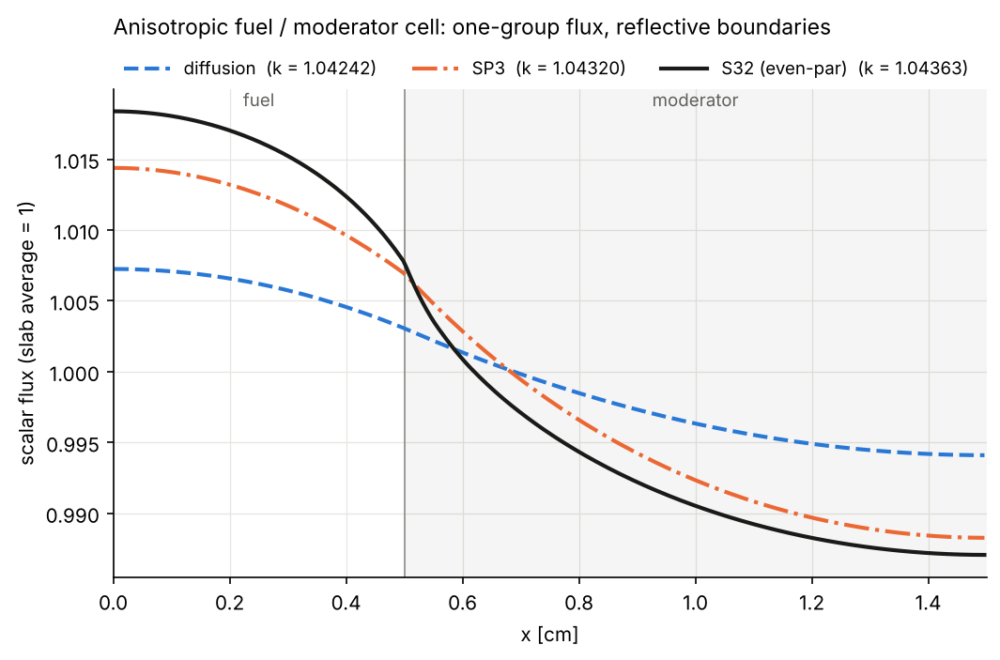
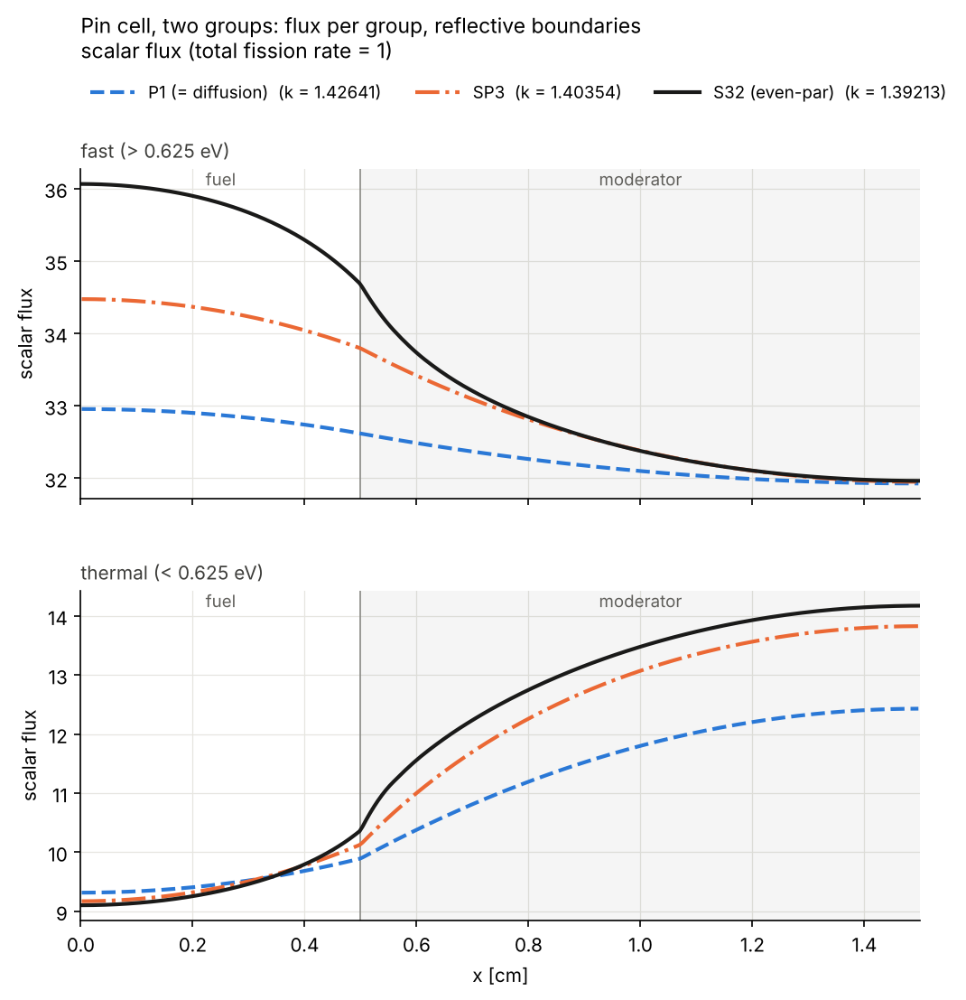
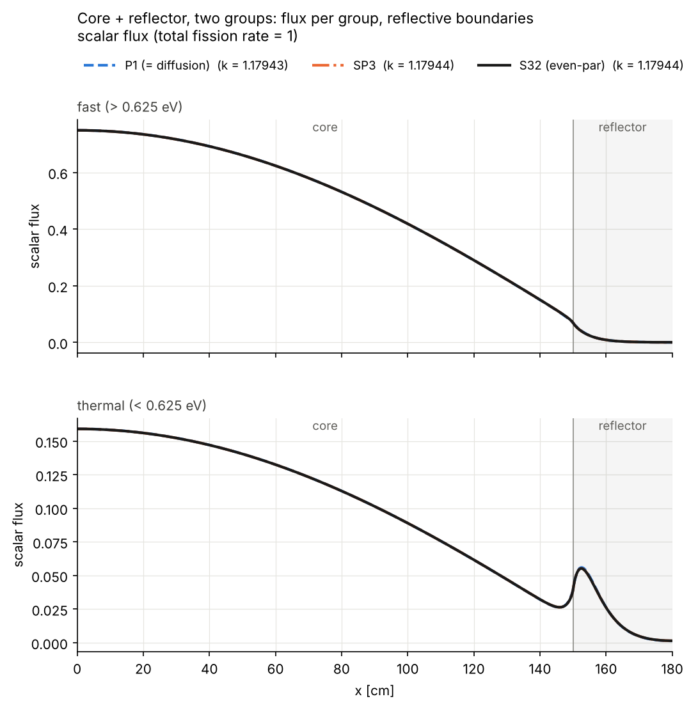

# slab1g — diffusion vs SP3 vs transport in a 1-group slab

Solves the one-group k-eigenvalue problem in a 1D slab made of homogeneous
zones (two by default), with **isotropic or anisotropic (Legendre P_L)
scattering**, isotropic fission and **reflective boundaries on both sides**,
using three angular approximations:

| model | unknowns | equations | scattering moments used |
|---|---|---|---|
| Diffusion (P1) | φ | 1 second-order equation | Σs₀, Σs₁ (transport-corrected D) |
| SP3 (≡ P3 in slab geometry) | Φ₀ = φ₀ + 2φ₂, φ₂ | 2 coupled second-order equations | Σs₀ … Σs₃ |
| Transport, even-parity S_N | ψ⁺(x, μₘ), μₘ > 0 | N/2 coupled second-order equations | Σs₀ … Σs_(N−1) |

All three are discretised with continuous Lagrange finite elements assembled by
[nutils](https://nutils.org); the eigenproblem `A u = (1/k) F u` is solved with
ARPACK on `A⁻¹F`. Transport at high order (S32 in the examples) is the
reference that diffusion and SP3 are compared against.



## Install and run

```bash
pip install -e ".[test]"
slab1g examples/anisotropic_cell.toml --sn 4 8 16 32 --plot flux.png --csv flux.csv
pytest
```

The last `--sn` order is used as the transport reference. Add `--norm fission` to
normalise every flux to a total fission rate of 1 instead of a slab-average flux of 1.

## Example: fuel/moderator cell with anisotropic scattering

`examples/anisotropic_cell.toml` is half of a symmetric lattice cell: 0.5 cm of
fuel next to 1 cm of moderator, reflected on both sides. The moderator scatters
forward (mean cosine ≈ 0.51, moments up to P3); the fuel is nearly isotropic.

```toml
title = "Anisotropic fuel / moderator cell"

[mesh]
elements_per_mfp = 8        # elements per mean free path, per zone
min_elements_per_zone = 16
degree = 2                  # Lagrange polynomial degree

[[zone]]                    # zones are listed from x = 0 to x = L
name = "fuel"
thickness = 0.5             # cm
sigma_s = 0.37              # 1/cm, scattering (P0 moment Σs0)
sigma_s_l = [0.03]          # higher Legendre moments [Σs1, ...]; omit for isotropic
sigma_c = 0.12              # capture
sigma_f = 0.10              # fission
nu = 2.5

[[zone]]
name = "moderator"
thickness = 1.0
sigma_s = 1.20
sigma_s_l = [0.61, 0.20, 0.05]   # Σs1, Σs2, Σs3
sigma_c = 0.01
sigma_f = 0.0
```

Output (`docs/anisotropic_cell.txt`):

```
  zone 1 fuel       t=0.5  St=0.59  Ss=0.37  Sc=0.12  Sf=0.1  nu=2.5  (0.29 mfp)
         anisotropic P1: Ss1=0.03  (mean cosine 0.081)
  zone 2 moderator  t=1  St=1.21  Ss=1.2  Sc=0.01  Sf=0  nu=2.43  (1.21 mfp)
         anisotropic P3: Ss1=0.61, Ss2=0.2, Ss3=0.05  (mean cosine 0.508)

Reference: S32 (even-par)

method                  k   dk [pcm]  max|dphi|/phi   rms dphi     zone 1     zone 2
------------------------------------------------------------------------------------
diffusion        1.042424     -115.1      1.094e-02  7.701e-03    1.00585    0.99708
SP3              1.043201      -40.7      3.925e-03  2.693e-03    1.01191    0.99405
S4 (even-par)    1.043201      -40.7      3.925e-03  2.693e-03    1.01191    0.99405
S8 (even-par)    1.043549       -7.3      1.162e-03  5.523e-04    1.01464    0.99268
S16 (even-par)   1.043615       -1.0      3.526e-04  1.248e-04    1.01516    0.99242
S32 (even-par)   1.043625        0.0      0.000e+00  0.000e+00    1.01524    0.99238
```

S4 reproduces SP3 to every printed digit, as it must in slab geometry. The
same cell with isotropic scattering (`examples/fuel_moderator.toml`) gives
k = 1.044115 at S32, so the forward scattering in the moderator is worth about
−47 pcm here; the diffusion and SP3 errors relative to transport are almost the
same in both cases.

All examples (Δk relative to S32):

| example | zones (optical thickness) | scattering | diffusion Δk | SP3 Δk | max flux error diff. / SP3 |
|---|---|---|---|---|---|
| `anisotropic_cell` | 0.29 + 1.21 mfp | P1 / P3 | −115 pcm | −41 pcm | 1.1 % / 0.39 % |
| `fuel_moderator` | 0.29 + 1.21 mfp | isotropic | −111 pcm | −39 pcm | 1.1 % / 0.38 % |
| `strong_absorber` | 0.54 + 1.51 mfp | isotropic | −9 pcm | −2 pcm | 0.60 % / 0.12 % |
| `thick_two_zone` | 18.2 + 15.1 mfp | isotropic | −1.6 pcm | 0.0 pcm | 0.22 % / 0.03 % |

Diffusion errors concentrate at the material interface and in optically thin
zones; SP3 removes most of them at twice the cost of diffusion.

## Input notes

- Σa = Σc + Σf and Σt = Σs + Σa are derived. Any number of zones works; at least one must be fissile.
- `sigma_s_l` holds absolute Legendre moments, so Σs₁ = μ̄₀ Σs₀. The scattering kernel is
  Σs(μ₀) = Σ_l (2l+1)/2 Σs_l P_l(μ₀). Moments must satisfy |Σs_l| ≤ Σs₀.
- A truncated expansion can make Σs(μ₀) negative at some angles (typical for strongly forward-peaked
  scattering at low order). This raises a warning; the solution is still well defined.
- An N-point quadrature resolves moments only up to P_(N−1); higher ones are dropped with a warning (e.g. S2 on a P3 zone).
- Fluxes are normalised to a slab-average scalar flux of 1 by default. `--norm fission` (or
  `solve_all(..., norm="fission")`) instead scales each model's flux so the total fission rate
  ∫Σf φ dx over the slab is 1 (per unit transverse area); k and the flux shape are unaffected.

Python API:

```python
from slab1g import SlabProblem, Zone, solve_all
p = SlabProblem([Zone(0.5, 0.37, 0.12, 0.10, 2.5, "fuel", sigma_s_l=(0.03,)),
                 Zone(1.0, 1.20, 0.01, 0.0, name="moderator", sigma_s_l=(0.61, 0.20, 0.05))])
for r in solve_all(p, sn_orders=(8, 32)):
    print(r.summary())        # r.k, r.x, r.phi, r.zone_avg
```

## Equations

Per zone: Σt total, Σs_l Legendre scattering moments, σₙ = Σt − Σs_n
(σ₀ = Σa), νΣf. Reflective boundaries make every odd angular moment vanish at
x = 0 and x = L, which is the *natural* boundary condition of each weak form
below, so no boundary terms appear. Interface conditions (continuity of the
even unknowns and of the currents) are also natural for a continuous FE basis.

**Diffusion**

    −(D φ′)′ + Σa φ = (1/k) νΣf φ,    D = 1/(3σ₁)

**SP3** (Brantley & Larsen form), scalar flux φ = Φ₀ − 2φ₂:

    −(Φ₀′/(3σ₁))′ + Σa(Φ₀ − 2φ₂)                     =  (1/k) νΣf (Φ₀ − 2φ₂)
    −(9φ₂′/(35σ₃))′ + σ₂ φ₂ − (2/5) Σa(Φ₀ − 2φ₂)     = −(2/5)(1/k) νΣf (Φ₀ − 2φ₂)

With isotropic scattering σ₁ = σ₂ = σ₃ = Σt.

**Even-parity S_N** on positive Gauss–Legendre directions, ψ± = [ψ(μ) ± ψ(−μ)]/2.
Even scattering moments act on ψ⁺, odd moments on ψ⁻:

    μ ψ⁺′ + T ψ⁻ = 0,                  T = Σt I − S_odd
    μ ψ⁻′ + Σt ψ⁺ = S_even ψ⁺ + (νΣf/2k) φ

    S_par[m, n] = Σ_(l of that parity) (2l+1) Σs_l P_l(μₘ) P_l(μₙ) wₙ

Eliminating ψ⁻ = −T⁻¹ μ ψ⁺′:

    −(μ T⁻¹ μ ψ⁺′)′ + (Σt I − S_even) ψ⁺ = (νΣf/2k) φ,    φ = Σₘ 2wₘ ψ⁺ₘ

Multiplying the rows by W = diag(w) makes everything symmetric. With isotropic
scattering T = Σt I and the angular stiffness is diagonal (μₘ²/Σt); with odd
moments it is a dense N/2 × N/2 matrix per zone, still local in space.

## Multigroup (e.g. two groups)

`slab1g.multigroup` solves the G-group problem with the same three models on the
same nutils mesh. All groups are solved together as one eigenproblem
`A u = (1/k) F u` (no inner/outer iterations), so down-scatter, up-scatter and the
fission spectrum χ are simply off-diagonal blocks. A TOML file with a `groups`
key is routed to the multigroup solver automatically:

```bash
slab1g examples/pincell_2g.toml --sn 8 16 32 --norm fission --plot flux.png
slab1g examples/reactor_2g.toml --sn 8 16 32 --norm fission --plot flux.png
```

Input per zone (G = 2, group boundary 0.625 eV in the examples):

```toml
groups = 2
group_names = ["fast (> 0.625 eV)", "thermal (< 0.625 eV)"]
chi = [1.0, 0.0]                 # default fission spectrum (can be set per zone)

[[zone]]
name = "fuel"
thickness = 0.5
sigma_s   = [[0.330, 0.002],     # Σs0(g -> g'), row = from-group
             [0.000, 0.380]]
sigma_s_l = [[[0.033, 0.000],    # [P1 matrix, P2 matrix, ...] (optional)
              [0.000, 0.010]]]
sigma_c = [0.010, 0.065]
sigma_f = [0.003, 0.200]
nu      = [2.60, 2.43]
```

Σt,g = Σc,g + Σf,g + Σ_g' Σs0(g → g'). With moment removal matrices
R_l = diag(Σt) − S_lᵀ, the models are

- **P1 (= diffusion):** −(D φ′)′ + R₀ φ = (1/k) χ νΣfᵀ φ, with D = R₁⁻¹/3
  (diagonal D_g = 1/(3(Σt,g − Σs1,g→g)) when the P1 matrix is diagonal).
- **SP3:** the one-group equations with σₙ replaced by the matrices Rₙ.
- **Even-parity S_N:** the angular stiffness becomes μ T⁻¹ μ with
  T = diag(Σt) ⊗ I − S_odd over the combined (group, direction) index.





Checks (`tests/test_multigroup.py`): G = 1 reproduces the one-group code to
round-off; with down- and up-scatter and P3 transfer matrices S2 ≡ P1 and
S4 ≡ SP3; infinite medium gives the analytic k∞; neutron balance; and agreement
with an independent multigroup diamond-difference S_N code (`reference.dd_sn_mg`).

## Implementation

```
src/slab1g/
  problem.py    Zone / SlabProblem, Legendre scattering moments, TOML loader
  fem.py        nutils mesh (zone-aligned) and per-zone stiffness/mass matrices
  solvers.py    diffusion, SP3, even-parity S_N, eigen solver
  reference.py  independent diamond-difference S_N, one-group and multigroup (numpy only)
  multigroup.py G-group P1, SP3 and even-parity S_N (one coupled eigenproblem)
  cli.py        comparison table, figure, CSV (mgcli.py for multigroup inputs)
```

`fem.py` assembles, once, `K_z = ∫_z φᵢ′φⱼ′` and `M_z = ∫_z φᵢφⱼ` on each zone's
sub-topology. Every operator in every model is built from these with the zone's
cross sections (for S_N, as Kronecker products with the zone's angular
matrices), so all three models share one mesh and their fluxes are compared at
identical points.

## Verification (`tests/`)

- **Infinite medium:** two identical zones → k = νΣf/Σa and a flat flux for every model, with and without anisotropy.
- **S2 ≡ (transport-corrected) diffusion and S4 ≡ SP3** to round-off, isotropic and P3-anisotropic (the slab-geometry S_N ≡ P_(N−1) equivalence), which checks both derivations against each other.
- **Neutron balance:** no leakage, so k = ∫νΣfφ / ∫Σaφ for each model.
- **Independent transport code:** nutils even-parity S16 agrees with diamond-difference S16 sweeps to 2·10⁻⁶ in k, isotropic and anisotropic.
- Scattering-kernel normalisation, input validation, monotone angular convergence and mesh convergence.

## License

MIT
