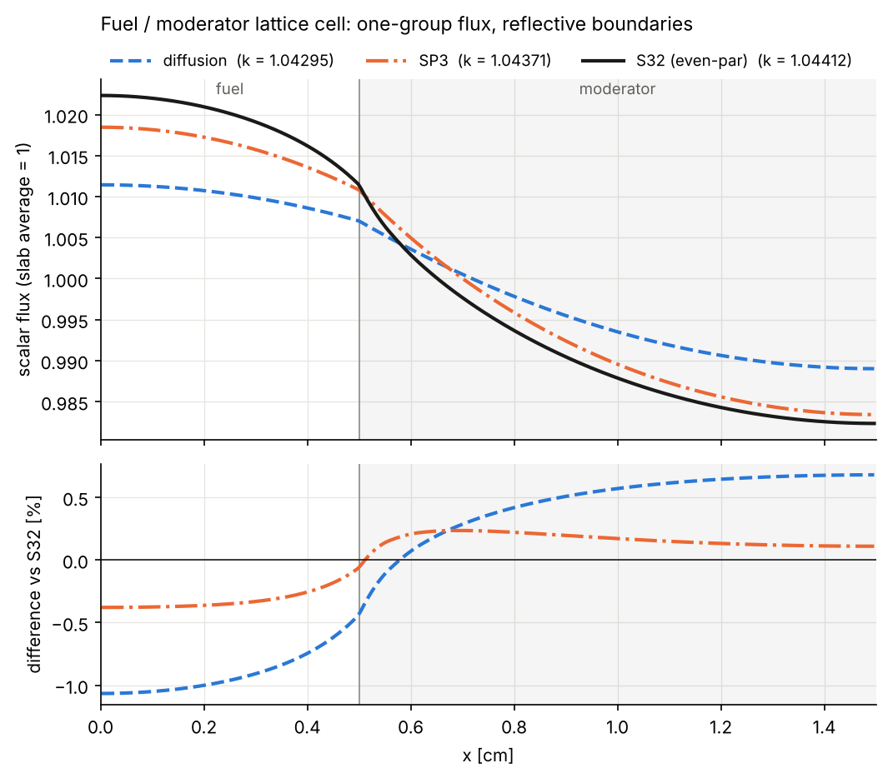

# slab1g — diffusion vs SP3 vs transport in a 1-group slab

Solves the one-group k-eigenvalue problem in a 1D slab made of homogeneous
zones (two by default), with **isotropic scattering and fission** and
**reflective boundaries on both sides**, using three angular approximations:

| model | unknowns | equations |
|---|---|---|
| Diffusion (P1) | φ | 1 second-order equation |
| SP3 (≡ P3 in slab geometry) | Φ₀ = φ₀ + 2φ₂, φ₂ | 2 coupled second-order equations |
| Transport, even-parity S_N | ψ⁺(x, μₘ), μₘ > 0 | N/2 coupled second-order equations |

All three are discretised with continuous Lagrange finite elements assembled by
[nutils](https://nutils.org); the eigenproblem `A u = (1/k) F u` is solved with
ARPACK on `A⁻¹F`. Transport at high order (S32 by default in the examples) is the
reference that diffusion and SP3 are compared against.



## Install and run

```bash
pip install -e ".[test]"
slab1g examples/fuel_moderator.toml --sn 4 8 16 32 --plot flux.png --csv flux.csv
pytest
```

The last `--sn` order is used as the transport reference.

Example output (fuel/moderator cell, `docs/fuel_moderator.txt`):

```
method                  k   dk [pcm]  max|dphi|/phi   rms dphi     zone 1     zone 2
------------------------------------------------------------------------------------
diffusion        1.042953     -111.3      1.065e-02  7.469e-03    1.00997    0.99502
SP3              1.043711      -38.7      3.785e-03  2.584e-03    1.01592    0.99204
S8 (even-par)    1.044039       -7.3      1.161e-03  5.532e-04    1.01851    0.99074
S16 (even-par)   1.044105       -1.0      3.562e-04  1.264e-04    1.01904    0.99048
S32 (even-par)   1.044115        0.0      0.000e+00  0.000e+00    1.01912    0.99044
```

| example | zones (optical thickness) | diffusion Δk | SP3 Δk | max flux error diff. / SP3 |
|---|---|---|---|---|
| `fuel_moderator` | 0.29 + 1.21 mfp | −111 pcm | −39 pcm | 1.1 % / 0.38 % |
| `strong_absorber` | 0.54 + 1.51 mfp | −9 pcm | −2 pcm | 0.60 % / 0.12 % |
| `thick_two_zone` | 18.2 + 15.1 mfp | −1.6 pcm | 0.0 pcm | 0.22 % / 0.03 % |

Diffusion errors concentrate at the material interface and in optically thin
zones; SP3 removes most of them at twice the cost of diffusion.

## Problem input (TOML)

```toml
title = "Fuel / moderator lattice cell"

[mesh]
elements_per_mfp = 8        # elements per mean free path, per zone
min_elements_per_zone = 16
degree = 2                  # Lagrange polynomial degree

[[zone]]                    # zones are listed from x = 0 to x = L
name = "fuel"
thickness = 0.5             # cm
sigma_s = 0.37              # 1/cm, isotropic scattering
sigma_c = 0.12              # capture
sigma_f = 0.10              # fission
nu = 2.5

[[zone]]
name = "moderator"
thickness = 1.0
sigma_s = 1.20
sigma_c = 0.01
sigma_f = 0.0
```

Derived: Σa = Σc + Σf, Σt = Σs + Σa. Any number of zones works; at least one
must be fissile. Fluxes are normalised to a slab-average scalar flux of 1.

Python API:

```python
from slab1g import SlabProblem, Zone, solve_all
p = SlabProblem([Zone(0.5, 0.37, 0.12, 0.10, 2.5, "fuel"),
                 Zone(1.0, 1.20, 0.01, 0.0, name="moderator")])
for r in solve_all(p, sn_orders=(8, 32)):
    print(r.summary())        # r.k, r.x, r.phi, r.zone_avg
```

## Equations

Per zone: Σt total, Σs scattering, Σa = Σt − Σs, νΣf. Reflective boundaries make
every odd angular moment vanish at x = 0 and x = L, which is the *natural*
boundary condition of each weak form below, so no boundary terms appear.
Interface conditions (continuity of the even unknowns and of the currents) are
also natural for a continuous FE basis.

**Diffusion**

    −(D φ′)′ + Σa φ = (1/k) νΣf φ,    D = 1/(3Σt)

**SP3** (Brantley & Larsen form, isotropic scattering), scalar flux φ = Φ₀ − 2φ₂:

    −(Φ₀′/(3Σt))′ + Σa(Φ₀ − 2φ₂)                     =  (1/k) νΣf (Φ₀ − 2φ₂)
    −(9φ₂′/(35Σt))′ + Σt φ₂ − (2/5) Σa(Φ₀ − 2φ₂)     = −(2/5)(1/k) νΣf (Φ₀ − 2φ₂)

**Even-parity S_N**, ψ⁺ = [ψ(μ) + ψ(−μ)]/2 on positive Gauss–Legendre directions:

    −(μₘ²/Σt ψₘ′)′ + Σt ψₘ = ½ (Σs + νΣf/k) φ,    φ = Σₘ 2wₘ ψₘ

Rows are scaled by wₘ so A and F are symmetric.

## Implementation

```
src/slab1g/
  problem.py    Zone / SlabProblem, TOML loader
  fem.py        nutils mesh (zone-aligned) and per-zone stiffness/mass matrices
  solvers.py    diffusion, SP3, even-parity S_N, eigen solver
  reference.py  independent diamond-difference S_N (numpy only) for verification
  cli.py        comparison table, figure, CSV
```

`fem.py` assembles, once, `K_z = ∫_z φᵢ′φⱼ′` and `M_z = ∫_z φᵢφⱼ` on each zone's
sub-topology. Every operator in every model is a linear combination of these
with the zone's cross sections, so all three models share one mesh and their
fluxes are compared at identical points.

## Verification (`tests/`)

- **Infinite medium:** two identical zones → k = νΣf/Σa and a flat flux for every model.
- **S2 ≡ diffusion and S4 ≡ SP3** to round-off (the slab-geometry S_N ≡ P_(N−1) equivalence), which checks the SP3 implementation independently.
- **Neutron balance:** no leakage, so k = ∫νΣfφ / ∫Σaφ for each model.
- **Independent transport code:** nutils even-parity S16 agrees with diamond-difference S16 sweeps to 2·10⁻⁶ in k.
- Monotone angular convergence (diffusion → SP3 → S8 → S16 → S32) and mesh convergence.

## License

MIT
